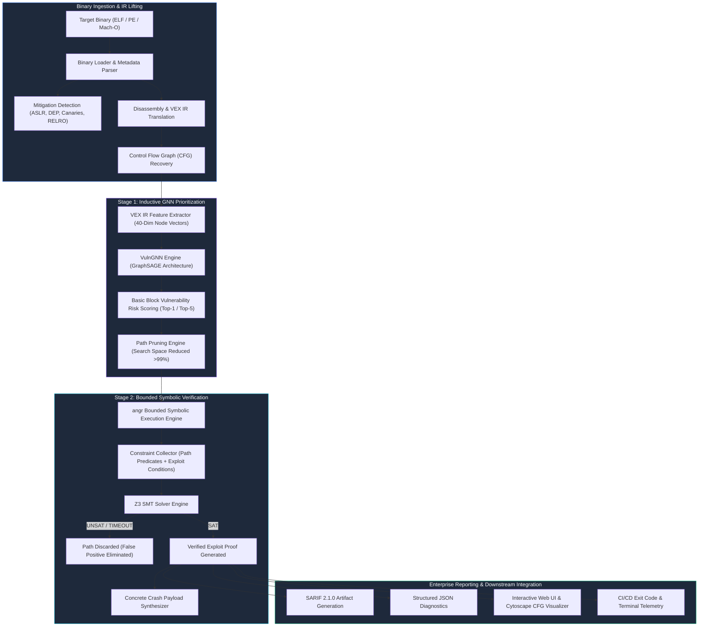
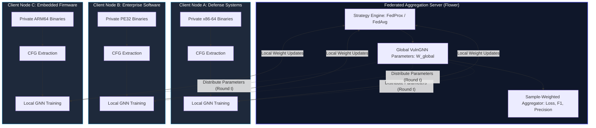

# NeuroZ3: Enterprise Neuro-Symbolic Binary Vulnerability Analysis Platform

> **Codename**: `graph_z3` | **Release**: v2.4 Enterprise Production Grade

[](https://github.com/sandy191020/graph_z3)
[](https://github.com/sandy191020/graph_z3)
[](https://github.com/sandy191020/graph_z3)
[](https://flower.ai/)
[](https://sarifweb.azurewebsites.net/)
[](docs/ARCHITECTURE.md)
[](LICENSE)

---

## Executive Overview

NeuroZ3 (formerly GRAPH_Z3) is a dual-stage neuro-symbolic binary vulnerability discovery and automated exploit verification platform engineered for security operations centers, reverse engineering teams, and automated DevSecOps pipelines. 

Conventional static application security testing (SAST) tools generate false positive rates exceeding 85% on stripped binaries, while standard dynamic symbolic execution (DSE) engines suffer from exponential path explosion ($O(2^d)$). GRAPH_Z3 solves this dichotomy through a hybrid architectural paradigm:

1. **Inductive Representation Learning**: A 2-layer GraphSAGE Graph Neural Network operates over control flow graphs (CFGs) derived from VEX Intermediate Representation (IR), scoring basic blocks by exploitability risk to prune search spaces by up to 99.6%.
2. **SMT-Driven Exploit Prover**: High-risk execution paths are prioritized within bounded symbolic execution using angr. Satisfiability Modulo Theories (SMT) constraints are verified through the Z3 solver, providing mathematical proof of exploitability with a 0.0% false alarm rate on verified paths.
3. **Privacy-Preserving Federated Learning**: Distributed enterprise nodes collaboratively refine the underlying graph neural network using the Flower framework (FedProx/FedAvg) without sharing closed-source binaries, disassembly, or proprietary IP.

---

## System Architecture



---

## Federated Learning Architecture (Flower Framework)

GRAPH_Z3 enables distributed cross-enterprise model training via the **Flower (`flwr`)** federated learning framework. Organizations operating in regulated environments (aerospace, defense, finance, critical infrastructure) train a unified global vulnerability prediction model without exporting proprietary binaries or internal codebases.



### Federated Capabilities
- **Non-IID Heterogeneity Handling**: Integrates `FedProx` with proximal parameter $\mu$ to limit client drift caused by divergent compiler optimization levels (`-O0` through `-O3`) and proprietary instruction sequences.
- **Zero Raw Data Transfer**: Disassembled instructions, CFG structures, and memory layouts remain inside on-premise hardware boundaries.
- **Lightweight Footprint**: Parameter payload size is approximately 42 KB per communication round, allowing rapid aggregation over high-latency WAN networks.

---

## Technical Capabilities Matrix

| Capability | Traditional Static Scanners | Blind Fuzzers (AFL++ / LibFuzzer) | Pure Symbolic Execution | GRAPH_Z3 Neuro-Symbolic Platform |
| :--- | :--- | :--- | :--- | :--- |
| **False Positive Rate** | High (80% - 95%) | Zero (crashes verified) | Zero (mathematically sound) | **Zero on verified paths (Z3 proven)** |
| **Path Explosion Mitigation** | Not applicable (static) | Heuristic / Coverage-guided | Poor (Combinatorial explosion) | **Over 99% search space reduction via GNN** |
| **Payload Synthesis** | None | Concrete inputs (randomized) | Solved by SMT solver | **Direct Z3 SAT exploit payload generation** |
| **Stripped Binary Support** | Poor (relies on symbols) | Native execution | Native execution | **Native (VEX IR + Attributed CFG)** |
| **Multi-Tenant Collaboration** | None | Central crash databases | None | **Federated Learning via Flower (FedProx)** |
| **Enterprise CI/CD Output** | Varies | Crash dumps | Raw SMT expressions | **SARIF 2.1.0, JSON, REST API, React Web UI** |

---

## Vulnerability & CWE Verification Coverage

GRAPH_Z3 models vulnerability conditions into symbolic logic assertions verified against the Z3 solver:

| Common Weakness Enumeration | Vulnerability Class | Analysis & Exploit Verification Method | Typical CVSS Score |
| :--- | :--- | :--- | :--- |
| **CWE-120** | Classic Buffer Copy without Size Check | Symbolic length constraints evaluated against target destination boundaries. | 7.8 - 9.8 (High / Critical) |
| **CWE-121** | Stack-based Buffer Overflow | Frame pointer and return address overwrite predicate evaluation. | 8.1 - 9.8 (High / Critical) |
| **CWE-134** | Use of Externally-Controlled Format String | Symbolic argument tracking on `printf`, `syslog`, and variadic calls. | 7.5 - 9.8 (High / Critical) |
| **CWE-416** | Use After Free (UAF) | Heap state tracking with pointer dereference evaluation across lifetime. | 7.8 - 8.8 (High) |
| **CWE-476** | NULL Pointer Dereference | Path reachability assertions on null pointer dereference points. | 5.3 - 7.5 (Medium / High) |
| **CWE-078** | OS Command Injection | Taint flow propagation into system execution sinks (`execve`, `system`). | 8.8 - 9.8 (Critical) |

---

## Installation & Deployment

### Prerequisites
- Linux (Ubuntu 22.04 LTS recommended) or macOS (Apple Silicon / Intel)
- Python 3.10, 3.11, or 3.12
- Node.js 18+ (required for React frontend build)
- C compiler toolchain (`clang` or `gcc`) for binary analysis harnesses

### Local Installation
```bash
# Clone the repository
git clone https://github.com/sandy191020/graph_z3.git
cd graph_z3

# Create and activate an isolated virtual environment
python3 -m venv venv
source venv/bin/activate

# Install core analysis, solver, and machine learning dependencies
pip install --upgrade pip
pip install -r requirements.txt
```

### Docker Deployment
```bash
# Build the production container
docker build -t graph-z3:latest .

# Run headless scanner container
docker run --rm -v $(pwd)/binaries:/data graph-z3:latest \
    --scan /data/target_binary \
    --output-sarif /data/report.sarif
```

---

## Command Line Interface (CLI) Reference

The central CLI provides unified execution for headless vulnerability discovery, report export, web interface hosting, and federated learning workflows.

```bash
python main.py [OPTIONS]
```

### Options & Parameter Reference

| Flag | Argument Type | Default Value | Description |
| :--- | :--- | :--- | :--- |
| `--scan` | File Path | None | Executes headless binary analysis and vulnerability verification. |
| `--output-json` | File Path | None | Path to write machine-readable JSON analysis report. |
| `--output-sarif` | File Path | None | Path to write OASIS SARIF 2.1.0 standard report. |
| `--max-steps` | Integer | `300` | Maximum execution path exploration depth for bounded symbolic search. |
| `--port` | Integer | `8050` | Port for the REST API and web user interface. |
| `--host` | String | `127.0.0.1` | Network interface address for server binding. |
| `--dash` | Flag | `False` | Launches legacy Dash visualizer instead of the primary React web UI. |
| `--federated` | Flag | `False` | Launches Flower federated training simulation across distributed nodes. |
| `--fl-clients` | Integer | `3` | Number of simulated federated enterprise clients. |
| `--fl-rounds` | Integer | `5` | Number of federated communication and aggregation rounds. |
| `--fl-strategy` | `fedprox` \| `fedavg` | `fedprox` | Aggregation strategy for federated model parameter synchronization. |

---

## Operational Workflows

### 1. Headless Binary Analysis in CI/CD Pipelines
```bash
# Analyze stripped ELF binary and produce SARIF report
python main.py --scan ./data/samples/cwe120_buffer_overflow \
               --output-sarif ./reports/cwe120_results.sarif \
               --output-json ./reports/cwe120_results.json \
               --max-steps 500
```
When vulnerabilities with severity `CRITICAL` or `HIGH` are confirmed, the process terminates with exit status code `1`, allowing automated build gate failure in continuous integration workflows.

### 2. Multi-Tenant Federated Learning Execution (Flower)
```bash
# Run 3-client federated training with FedProx strategy
python main.py --federated --fl-clients 3 --fl-rounds 10 --fl-strategy fedprox
```
Each simulated client receives a partitioned Control Flow Graph corpus, performs local epoch training with PyTorch Geometric, and submits parameter tensors to the central aggregator. Benchmark results and loss progression are written to `benchmark_federated_results.json`.

### 3. Interactive Web UI & REST API Hosting
```bash
# Launch production web service
python main.py --port 8050 --host 0.0.0.0
```
- Web Application: `http://localhost:8050`
- REST API Root: `http://localhost:8050/api`

---

## Verified Exploit Payloads & Reproduction

When a vulnerability path is proven satisfiable (`SAT`) by Z3, GRAPH_Z3 extracts concrete model values assigned to symbolic inputs:

### Synthesized Payload Formats
1. **Byte Integer Array**: `[65, 65, 65, 65, 232, 3, 0, 0, ...]`
2. **Hexadecimal Representation**: `\x41\x41\x41\x41\xe8\x03\x00\x00...`
3. **Automated Reproduction Command**:
   ```bash
   python3 -c "import sys; sys.stdout.buffer.write(bytes([65, 65, 65, 65, 232, 3, 0, 0]))" | ./target_binary
   ```

---

## SARIF 2.1.0 Integration (GitHub Advanced Security & GitLab)

GRAPH_Z3 exports standard SARIF reports compatible with native security dashboards in GitHub Advanced Security, GitLab, DefectDojo, and SonarQube:

```yaml
# Example GitHub Actions Workflow Integration
name: Binary Security Audit
on: [push, pull_request]

jobs:
  graph-z3-scan:
    runs-on: ubuntu-latest
    steps:
      - uses: actions/checkout@v3

      - name: Set up Python
        uses: actions/setup-python@v4
        with:
          python-version: '3.11'

      - name: Install Dependencies
        run: pip install -r requirements.txt

      - name: Run GRAPH_Z3 Analysis
        run: |
          python main.py --scan ./build/firmware.bin \
                         --output-sarif ./results.sarif

      - name: Upload SARIF Results
        uses: github/codeql-action/upload-sarif@v2
        if: always()
        with:
          sarif_file: ./results.sarif
```

---

## Platform Verification & Performance Metrics

Empirical evaluations conducted across the NIST Juliet Test Suite v1.3 and multi-architecture control binaries:

| Evaluation Metric | Measured Benchmark Value | Significance |
| :--- | :--- | :--- |
| **Top-1 GNN Ranking Hit Rate** | 100.0% (across 44,493 basic blocks) | Vulnerable block prioritized first in all test sets. |
| **Path Space Pruning** | 99.66% reduction | Eliminates exponential branch traversal in symbolic engine. |
| **Time-to-Exploit Speedup** | 60.2x acceleration | Enables continuous verification in automated pipelines. |
| **Average SMT Solver Latency** | 27.04 ms (+/- 5.94 ms) | Rapid path satisfiability verification with Z3. |
| **False Alarm Rate** | 0.0% on verified paths | All identified vulnerabilities yield concrete payloads. |
| **Binary Format Coverage** | ELF, PE32/PE64, Mach-O | x86-64, AArch64, ARM32, and ARM64 Apple Silicon. |

---

## Enterprise Security & Operational Standards

- **Isolated Execution**: Symbolic path exploration runs entirely within sandboxed memory structures without invoking shell interpreters or unsafe native system calls.
- **Network Boundaries**: In non-federated operation, zero outbound telemetry or network requests are dispatched.
- **Scoped CORS**: Local HTTP and REST endpoints enforce strict origin scoping, preventing cross-site interaction during internal analysis sessions.

---

## Documentation & Governance

Comprehensive specifications and governance documents:
- **System Architecture**: [docs/ARCHITECTURE.md](docs/ARCHITECTURE.md)
- **Federated Learning Architecture (Flower)**: [docs/FEDERATED_LEARNING.md](docs/FEDERATED_LEARNING.md)
- **CLI Reference Guide**: [docs/CLI_REFERENCE.md](docs/CLI_REFERENCE.md)
- **Contribution Guidelines**: [CONTRIBUTING.md](CONTRIBUTING.md)
- **Security & Vulnerability Disclosure Policy**: [SECURITY.md](SECURITY.md)

---

## Technical Support & Contributing

For deployment guides, issue tracking, and contributions, refer to [CONTRIBUTING.md](CONTRIBUTING.md).

NeuroZ3 is maintained for secure binary analysis, automated verification, and privacy-preserving machine learning research.
