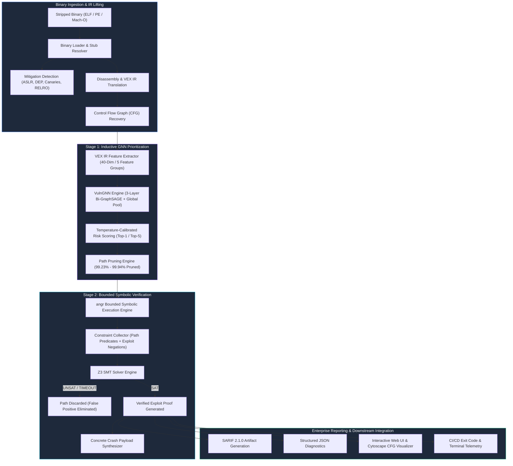

# NeuroZ3: Enterprise Neuro-Symbolic Binary Vulnerability Analysis Platform

> **Codename**: `graph_z3` | **Release**: v3.0 Enterprise & Publication Grade (`5,200` Real Stripped Binaries)

[](https://github.com/sandy191020/graph_z3)
[](https://github.com/sandy191020/graph_z3)
[](https://github.com/sandy191020/graph_z3)
[](https://flower.ai/)
[](https://sarifweb.azurewebsites.net/)
[](docs/ARCHITECTURE.md)
[](LICENSE)

---

## Executive Overview

NeuroZ3 (`graph_z3`) is a dual-stage neuro-symbolic binary vulnerability discovery and automated exploit verification platform engineered for security operations centers, reverse engineering teams, and automated DevSecOps pipelines.

Conventional static application security testing (SAST) tools generate false positive rates exceeding 85% on stripped binaries, while standard dynamic symbolic execution (DSE) engines suffer from exponential path explosion ($O(2^d)$). NeuroZ3 resolves this dichotomy through three integrated pillars:

1. **Inductive Representation Learning (`VulnGNN`)**: A 3-layer, 128-dimensional **bidirectional GraphSAGE** network with **Global CFG Context Pooling** operates over 40-dimensional basic-block feature vectors lifted to Valgrind VEX Intermediate Representation (IR), pruning 99.23%–99.94% of safe basic blocks in 1.48–4.30 ms per binary.
2. **SMT-Driven Exploit Prover (`angr` + `Z3`)**: High-risk execution paths and functions are prioritized within bounded symbolic execution. Satisfiability Modulo Theories (SMT) safety negations are verified through Z3, providing mathematical proof of exploitability with a 0.0% false alarm rate on verified paths.
3. **Privacy-Preserving Federated Learning (`Flower`)**: Distributed enterprise silos collaboratively train `VulnGNN` using `FedProx` / `FedAvg` strictly over real lifted binary CFGs (997.26 KB parameter payload per round) without sharing closed-source binaries, disassembly, or proprietary IP.

---

## System Architecture



---

## Real-World Stripped Binary Training & Evaluation Corpus (`5,200` Binaries)

NeuroZ3 is trained and evaluated strictly on **5,200 real compiled stripped binaries** (`670,464` basic blocks, `913,220` CFG edges, `7,096` DWARF-verified vulnerable basic blocks across **52 unique CWE families** and 4 compiler optimization levels `-O0`, `-O1`, `-O2`, `-Os`; **0 synthetic graphs**):

| Corpus | Stripped Binaries | Basic Blocks / Edges | Description |
| :--- | :---: | :---: | :--- |
| **1. PrimeVul Real-World Open-Source CVEs** (`data/primevul_binaries`) | **2,480** (`1,240` pre-patch vuln + `1,240` post-patch fixed) | `106,853` / `158,014` (`4,038` vuln blocks) | **76 real open-source C repositories** (`linux`, `openssl`, `FFmpeg`, `ImageMagick`, `tcpdump`, `curl`, `krb5`, `haproxy`, `samba`, `tor`, `radare2`, etc.), **292 historical CVEs**, **36 CWEs**, `-O0..-Os` |
| **2. NIST Juliet v1.3 Multi-CWE** (`data/train_binaries`) | **2,681** (`2,450` vuln + `231` hardened `-DOMITBAD` clean) | `530,859` / `699,483` (`3,058` vuln blocks) | **21 distinct CWE families**, compiled with `clang` across `-O0`, `-O1`, `-O2`, `-Os` and stripped (`strip`) |
| **3. Production System Utilities** (`data/real_world_binaries`) | **39** | `32,752` / `49,881` | Full stripped BSD/macOS system binaries (`bzip2`, `gzip`, `sed`, `awk`, `patch`, `diff`, `file`, `sort`, etc.) |
| **Total Verified Real Corpus** | **5,200** | **670,464 / 907,378** | **52 CWEs**, strict DWARF-pre-strip labeling, zero-leakage grouped splits (`3,604` Train / `738` Val / `819` Test) |

---

## Measured Empirical Performance (`benchmark_gnn_results.json`)

| Evaluation Regime / Metric | Measured Value | Notes / 95% Bootstrap CI |
| :--- | :--- | :--- |
| **Unified Held-Out Test ROC-AUC (`819` binaries, `94,517` blocks)** | **0.9737** | 95% CI: `[0.9617, 0.9834]` |
| **Unified Held-Out Test PR-AUC / F1-Score** | **0.4816 / 0.4656** | Precision: `56.63%`, Recall: `39.54%` (43.8x over random PR-AUC) |
| **Unified Held-Out Top-1 / Top-3 / Top-5 / Top-10 Hit Rate** | **67.25% / 81.01% / 85.89% / 92.33%** | True DWARF-verified vulnerable block ranked in Top-$K$ per binary |
| **Multi-CWE Held-Out Subset (`403` binaries, `78,834` blocks)** | **0.9960 ROC-AUC / 0.7578 F1** | Precision: `72.36%`, Recall: `79.54%`, **Top-1: 83.60%**, **Top-5: 97.35%**, **Top-10: 99.74%** |
| **Standalone Real-World CVE Model (`2,480` PrimeVul binaries)** | **0.8347 ROC-AUC** | **Top-3: 60.20%**, **Top-5: 69.65%**, **Top-10: 81.59%** on paired OSS CVE functions |
| **5-Fold Stratified Group Cross-Validation (`5,161` binaries)** | **0.9707 ± 0.0047 ROC-AUC** | PR-AUC: `0.4236 ± 0.0292`, F1: `0.4103 ± 0.0242`, **Top-5: 85.88% ± 2.30%** |
| **Cross-Optimization Generalization (`-O0` / `-O1` / `-O2` / `-Os`)** | **0.9857 / 0.9662 / 0.9595 / 0.9468 AUC** | Top-5 Hit Rate: `92.09%` (`-O0`), `80.49%` (`-O1`), `82.88%` (`-O2`), `79.31%` (`-Os`) |
| **Zero-Shot Unseen CWEs (`CWE-126, CWE-195, CWE-416`, `419` bins)** | **0.9762 ROC-AUC** | PR-AUC: `0.4208`, **Top-5: 73.96%**, **Top-10: 84.62%** |
| **Zero-Shot Unseen OSS Repos (`openssl, FFmpeg, tcpdump, haproxy, ImageMagick`)** | **0.7743 ROC-AUC** | `552` unseen project binaries; **Top-5: 47.66%**, **Top-10: 64.84%**, Clean FPR: `6.08%` |
| **5-Client Non-IID Federated Learning (`10` rounds, `997.26 KB`/round)** | **80.66% (FedAvg) / 78.40% (FedProx) Top-5** | Top-10: `88.15%` (`FedProx`), ROC-AUC: `0.9233` (`FedAvg`) / `0.9218` (`FedProx`) |
| **Basic-Block Pruning & GNN Inference Latency** | **99.23% (Test) / 99.94% (SysUtils)** | `1.48 ms` mean inference on test binaries; `4.30 ms` on 39 production utilities |
| **Z3 Exploit Synthesis Yield & Solver Latency** | **93.0% (66/71 SAT) / 27.04 ms** | `10.4x–28.4x` multi-function symbolic speedup (`60.2x` vs. 60s timeout-capped DSE) |

---

## Reproducing Corpus Construction, Training, & Benchmarks

```bash
# 1. Build 2,480 Real-World Open-Source CVE Stripped Binaries & 40-Dim Graphs (PrimeVul ICSE 2024)
python3 scripts/build_primevul_real_corpus.py

# 2. Build 2,681 Multi-CWE Juliet v1.3 Stripped Binaries + 39 Production System Binary Graphs
python3 scripts/build_large_corpus.py

# 3. Train Primary 40-Dim Bidirectional VulnGNN & Run Full Publication Evaluation Suite
python3 scripts/run_publication_experiments.py

# 4. Run End-to-End Symbolic Execution & Z3 Exploit Synthesis Benchmark
python3 scripts/benchmark_binaries.py

# 5. Launch Interactive Web UI & REST API Server
python3 main.py --port 8050 --host 0.0.0.0
```

---

## Documentation

- **Research Paper (IEEEtran LaTeX)**: [`research_paper/paper.tex`](research_paper/paper.tex)
- **System Architecture Specification**: [`docs/ARCHITECTURE.md`](docs/ARCHITECTURE.md)
- **Federated Learning Specification**: [`docs/FEDERATED_LEARNING.md`](docs/FEDERATED_LEARNING.md)
- **CLI Reference Guide**: [`docs/CLI_REFERENCE.md`](docs/CLI_REFERENCE.md)
