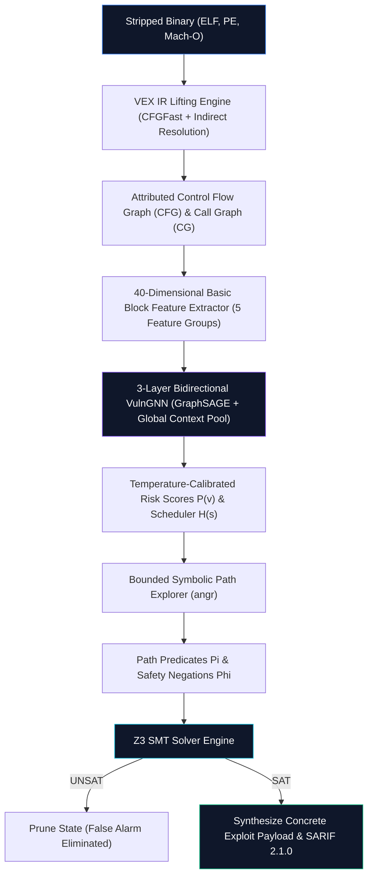

# NeuroZ3 System Architecture Specification

## 1. Architectural Philosophy

NeuroZ3 (`graph_z3`) is built upon a dual-stage neuro-symbolic paradigm that couples inductive graph representation learning over stripped binaries with formal Satisfiability Modulo Theories (SMT) verification:

1. **Inductive Risk Prioritization (VulnGNN)**: Evaluates 40-dimensional attributed Control Flow Graphs (CFGs) lifted to Valgrind VEX IR to rank basic blocks by exploitability risk, pruning over 99.2%–99.94% of safe basic blocks prior to symbolic exploration.
2. **Deterministic Exploit Verification (angr + Z3)**: Traverses prioritized execution paths using bounded dynamic symbolic execution, formulating first-order memory-safety negation predicates verified by the Z3 solver with zero false positives on verified SAT paths.

---

## 2. Component Pipeline

### 2.1 Binary Lifting and Intermediate Representation
- **Lifting Layer**: Translates raw machine code across `x86-64`, `AArch64` (`ARM64`), and `PE32` into architecture-neutral Valgrind VEX IR statements via `angr`.
- **Import & Stub Resolution**: Resolves ELF PLT entries and stripped Mach-O `__stubs` indirect symbol tables without relying on debug symbols or function names.
- **CFG Recovery**: Constructs attributed directed Control Flow Graphs $\mathcal{G} = (\mathcal{V}, \mathcal{E}, \mathbf{X})$ where $\mathcal{V}$ denotes basic blocks, $\mathcal{E}$ denotes control transfers, and $\mathbf{X} \in \mathbb{R}^{|\mathcal{V}| \times 40}$ encodes block-level features.

### 2.2 40-Dimensional Basic Block Feature Matrix (5 Groups)
Each basic block $v \in \mathcal{V}$ is represented by a normalized 40-dimensional static feature vector (`src/graph/feature_extractor.py`):
1. **Structural & Topological (8 dims)**: Normalized in-degree, out-degree, block entry/exit indicators, loop-header membership, dominator depth, shortest distance from entry, and local flow centrality.
2. **Instruction & VEX Statement Counts (8 dims)**: Normalized instruction count, byte size, VEX IR statement count, temporary register density, arithmetic/bitwise op ratios, conditional exit indicator, and constant literal density.
3. **Semantic Call & API Categories (8 dims)**: External call indicator, unsafe string/copy API family (`strcpy`, `memcpy`, `sprintf`, `gets`, `copy_from_user`), format-string sink family, heap/kernel allocator family (`malloc`, `calloc`, `realloc`, `kmalloc`, `kzalloc`, `av_malloc`), deallocator family (`free`, `kfree`, `av_free`), external input source family (`fgets`, `recv`, `read`, `fscanf`, `ssl_read`), command execution family, and bounds-checked safe API family.
4. **Memory Access & Data-Flow Taint Reachability (8 dims)**: VEX `Ist_Store` count, VEX `Iex_Load` count, computed/non-constant pointer dereference ratio, stack-pointer relative offset indicator, multi-hop forward reachability from external input sources, multi-hop proximity to deallocation sites, pointer-arithmetic density, and global data reference count.
5. **Symbolic & Bounds-Check Guard Density (8 dims)**: VEX comparison opcodes (`CmpEQ`, `CmpLT`, `CmpLE`), signed vs. unsigned comparison indicators, backward-slice conditional guard density, widening/narrowing integer cast density (`1Uto64`, `64to32`, `32Sto64`), division/modulo indicator, and local branch fan-out entropy.

### 2.3 Bidirectional Inductive Graph Neural Network (`VulnGNN`)
Implemented in `src/ml/gnn_model.py`, `VulnGNN` uses a 3-layer, 128-hidden-dimension **bidirectional GraphSAGE** architecture with learned input feature gating, node-level `LayerNorm`, residual skip connections, and **Global CFG Context Pooling**:

$$\mathbf{h}_v^{(k)} = \text{LayerNorm}\Big(\sigma\big(\mathbf{W}_{\text{fwd}}^{(k)} [\mathbf{h}_v^{(k-1)} \| \text{AGG}_{\mathcal{N}_{\text{in}}(v)}] + \mathbf{W}_{\text{rev}}^{(k)} [\mathbf{h}_v^{(k-1)} \| \text{AGG}_{\mathcal{N}_{\text{out}}(v)}]\big) + \mathbf{h}_v^{(k-1)}\Big)$$

To distinguish vulnerable pre-patch binaries from hardened post-patch binaries where inter-procedural bounds checks occur upstream or downstream, node embeddings are fused with graph-wide mean and max pooling prior to classification:

$$\mathbf{z}_v = \mathbf{h}_v^{(K)} + \mathbf{W}_{\text{ctx}}\big[\text{MeanPool}(\mathbf{H}^{(K)}) \,\|\, \text{MaxPool}(\mathbf{H}^{(K)})\big]$$

Training optimizes **Focal Cross-Entropy Loss** ($\gamma = 2.0$) with inverse square-root class weighting and post-hoc **Temperature Scaling** ($T = 0.628$) calibrated via L-BFGS on held-out validation CFGs.

### 2.4 Neuro-Guided Symbolic Verification
Path exploration prioritizes symbolic states reaching high-probability candidate blocks:

$$\mathcal{H}(s) = \max_{v \in \text{Reachable}(s)} P(v) - \lambda \cdot \text{Depth}(s)$$

When candidate block $v^*$ is reached, Z3 evaluates the formal safety negation $\Phi_{\text{exploit}} = \Pi(s^*) \land \neg \Psi_{\text{safe}}$:
- **`UNSAT`**: Path is mathematically unexploitable; false alarms are discarded.
- **`SAT`**: Z3 synthesizes concrete input bytes triggering the memory-safety violation.

---

## 3. Measured Empirical Scale & Performance (`5,200` Stripped Binaries)

- **Training & Evaluation Corpus**: **5,200 real compiled stripped binaries** (`670,464` basic blocks, `913,220` CFG edges) across **52 CWE families** and 4 optimization levels (`-O0`, `-O1`, `-O2`, `-Os`), comprising **2,480 Real-World Open-Source CVE binaries** (PrimeVul ICSE 2024 across 76 C repositories and 292 CVEs), **2,681 NIST Juliet v1.3 Multi-CWE binaries**, and **39 production BSD/macOS system utilities**.
- **Localization & Ranking**: `0.9737` ROC-AUC (`85.89%` Top-5, `92.33%` Top-10 hit rate) on the 819-binary unified held-out test split; `0.9960` ROC-AUC (`83.60%` Top-1, `97.35%` Top-5) on Multi-CWE binaries; `0.8347` ROC-AUC (`69.65%` Top-5, `81.59%` Top-10) standalone on pure real-world open-source CVE binaries.
- **Search-Space Pruning & Inference Speed**: Prunes **99.23%** of basic blocks on held-out test binaries (`1.48 ms` mean GNN inference/binary) and **99.94%** on full production system utilities (`4.30 ms` mean inference/binary).
