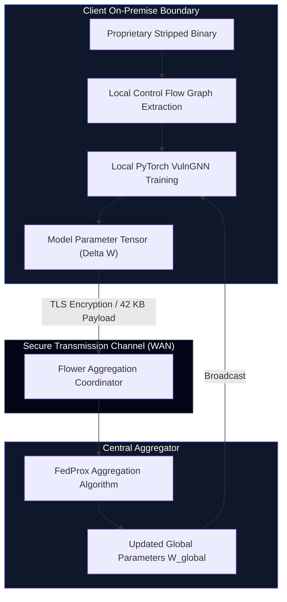

# NeuroZ3 Federated Learning Architecture (Flower Framework)

## 1. Overview

NeuroZ3 integrates privacy-preserving Federated Learning using the **Flower (`flwr`)** framework. This allows multiple organizations (e.g., aerospace contractors, financial enterprises, government research labs) to collaboratively train the inductive `VulnGNN` model without sharing private binaries, proprietary source code, or internal Control Flow Graphs (CFGs).

---

## 2. Privacy Guarantees



- **Zero Raw Data Transfer**: Disassembled instructions, CFG matrices, and concrete memory layouts never leave the local client enclave.
- **Minimal Communication Overhead**: The parameter vector for `VulnGNN` is approximately 42 KB, enabling rapid synchronization rounds across constrained or metered network connections.
- **Local Model Application**: Each organization runs its own private `angr` + `Z3` symbolic solver instances locally, benefiting from the collaboratively trained GNN prior.

---

## 3. Mathematical Formulation: FedProx Strategy

Binary vulnerability distributions across different organizations are inherently non-IID (Independent and Identically Distributed):
- Client A may possess predominantly memory safety flaws (CWE-120/121).
- Client B may possess primarily control flow and format string errors (CWE-134/416).
- Varied compiler optimization levels (`-O0` to `-O3`) introduce graph structural drift.

To mitigate client drift, NeuroZ3 employs the **FedProx** optimization objective:

$$\min_{\mathbf{w}} h_k(\mathbf{w}; \mathbf{w}^t) = F_k(\mathbf{w}) + \frac{\mu}{2} \|\mathbf{w} - \mathbf{w}^t\|^2$$

Where:
- $F_k(\mathbf{w})$ is the local empirical cross-entropy loss for client $k$.
- $\mathbf{w}^t$ represents the global parameter vector distributed at round $t$.
- $\mu \ge 0$ is the proximal regularization parameter penalizing excessive local divergence from the global consensus model.

---

## 4. Module Implementation Details

### Client Node: `FlowerVulnClient`
Located in `src/ml/federated/client.py`:
- Inherits from `flwr.client.NumPyClient`.
- Implements `get_parameters()`, `set_parameters()`, `fit()`, and `evaluate()`.
- Incorporates weighted cross-entropy loss to address the severe class imbalance inherent in basic block vulnerability detection (typically <1% of blocks in a binary are vulnerable).

### Aggregator: `create_federated_strategy`
Located in `src/ml/federated/server.py`:
- Provides strategy factory supporting both `FedProx` and `FedAvg`.
- Implements `aggregate_eval_metrics()` to compute sample-weighted F1 score, precision, and recall across clients.

---

## 5. Execution Guide

### Local Multi-Client Simulation
To simulate a 3-client federated training workflow locally:
```bash
python main.py --federated --fl-clients 3 --fl-rounds 5 --fl-strategy fedprox
```

### Distributed Client Connection
To connect an independent client to an active Flower server:
```python
import flwr as fl
from src.ml.federated.client import create_client

# Instantiate client with local binary CFG data loaders
client = create_client(
    client_id="node_defense_01",
    train_loader=local_train_loader,
    val_loader=local_val_loader,
    local_epochs=3
)

# Connect to centralized aggregation server
fl.client.start_numpy_client(
    server_address="coordinator.internal:8080",
    client=client
)
```
