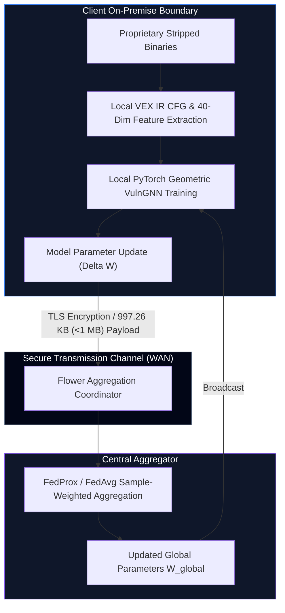

# NeuroZ3 Federated Learning Architecture (Flower Framework)

## 1. Overview

NeuroZ3 integrates privacy-preserving Federated Learning using the **Flower (`flwr`)** framework (`src/ml/federated/`). Multiple security-sensitive organizations (e.g., kernel maintainers, defense contractors, enterprise software vendors, embedded device manufacturers) collaboratively train the 40-dimensional bidirectional `VulnGNN` model **strictly on real compiled stripped binary CFGs** without sharing proprietary binaries, source code, or internal Control Flow Graphs.

> **Zero Synthetic Data Guarantee**: All synthetic graph generators have been removed from `src/ml/federated/simulation.py`; federated training and evaluation operate exclusively on real lifted `.pt` binary CFGs from `data/primevul_graphs` and `data/processed_graphs`.

---

## 2. Privacy & Bandwidth Guarantees



- **Zero Raw Data Transfer**: Disassembled instructions, symbol tables, CFG adjacency matrices, and memory layouts never leave the client enclave.
- **Compact Sub-Megabyte Synchronization**: The 3-layer, 128-dim bidirectional `VulnGNN` parameter tensor is **997.26 KB (`< 1 MB`)** per client per round (`255,300` float32 parameters), orders of magnitude smaller than fine-tuned code LLMs (hundreds of megabytes to gigabytes per round).
- **Local Formal Verification**: Each participating organization runs its own local `angr` + `Z3` symbolic verification engine over its private binaries using the collaboratively trained global GNN prior.

---

## 3. Mathematical Formulation: Non-IID Silos & FedProx

Real-world binary corpora across organizations are strongly **Non-IID**:
- Different organizations specialize in disjoint software domains (e.g., OS kernel drivers vs. user-space network daemons vs. embedded utilities) and face distinct vulnerability classes and compiler flags (`-O0` through `-Os`).

To bound multi-epoch local client drift across heterogeneous silos, NeuroZ3 supports **FedProx** proximal regularization alongside **FedAvg**:

$$\min_{\mathbf{w}} h_k(\mathbf{w}; \mathbf{w}^t) = F_k(\mathbf{w}) + \frac{\mu}{2} \|\mathbf{w} - \mathbf{w}^t\|_2^2$$

Where:
- $F_k(\mathbf{w})$ is client $k$'s class-weighted Focal Cross-Entropy loss ($\gamma = 2.0$) over its local binary CFGs.
- $\mathbf{w}^t$ is the global parameter vector broadcast at communication round $t$.
- $\mu = 0.002$ scales the $L_2$ proximal penalty commensurately with the 255K-parameter bidirectional GraphSAGE network.

---

## 4. Empirical Non-IID Evaluation (`3,604` Training Binaries Across 5 Disjoint Silos)

Evaluated across `3,604` real stripped training binaries partitioned into **5 disjoint organizational silos** (`426`, `622`, `828`, `704`, and `1,024` binaries respectively: Stack/OOB Memory Safety, Heap/Pointer Lifecycle, Arithmetic/Input-Taint, Linux Kernel CVEs, and User-Space OSS Daemons/Libraries CVEs) over 10 communication rounds (`6` local epochs/round) and tested on the unified `819`-binary held-out test set:

| Strategy | Payload / Round | Round 1 Top-5 | Round 5 Top-5 | Round 10 Top-5 | Held-Out ROC-AUC | Held-Out Recall |
| :--- | :---: | :---: | :---: | :---: | :---: | :---: |
| **FedProx ($\mu = 0.002$)** | 997.26 KB | 48.08% | 76.13% | **78.40%** (Top-10: 88.15%) | 0.9218 | **45.81%** |
| **FedAvg ($\mu = 0.0$)** | 997.26 KB | 54.70% | 78.57% | **80.66%** (Top-10: 87.11%) | **0.9233** | 37.90% |

Both federated strategies recover over 91% of centralized Top-5 localization recall (`80.66%` / `78.40%` vs. `85.89%` centralized) with zero sharing of raw binaries; `FedProx` yields higher recall (`45.81%` vs. `37.90%`) and Top-10 localization (`88.15%`) under aggressive local training epochs, while `FedAvg` achieves slightly higher precision (`24.52%` vs. `19.02%`).

---

## 5. Execution Guide

### Multi-Client Simulation on Real Stripped Binary CFGs
```bash
python main.py --federated --fl-clients 5 --fl-rounds 10 --fl-strategy fedprox
```

### Distributed Client Connection
```python
import flwr as fl
from src.ml.federated.client import FlowerVulnClient
from src.ml.gnn_model import create_model

model = create_model(input_dim=40, hidden_dim=128, num_layers=3, encoder="sage")
client = FlowerVulnClient(
    client_id="enclave_kernel_01",
    model=model,
    train_loader=local_train_loader,
    val_loader=local_val_loader,
    local_epochs=6,
)
fl.client.start_numpy_client(server_address="coordinator.internal:8080", client=client)
```
